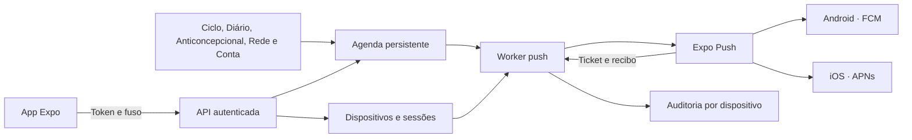
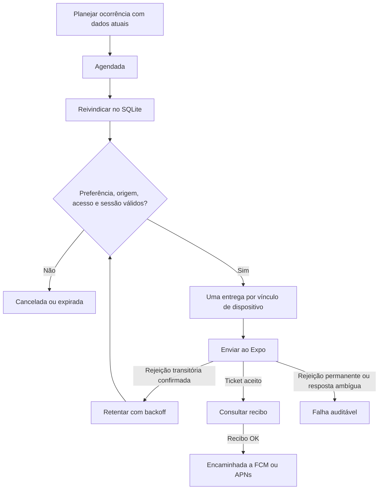

# Notificações push do Aloya

O aplicativo recebe notificações nativas por Expo Push. O Expo encaminha para FCM v1 no Android e APNs no iOS. O backend mantém a agenda e o histórico de processamento no SQLite. O toque no aviso resolve o destino pela sessão autenticada, dentro das telas existentes.

## Contratos

| Rota | Uso |
|---|---|
| `GET /api/preferencias-notificacao` | Preferências salvas e estado efetivo por evento |
| `GET /api/preferencias-notificacao/padroes` | Padrões e grupos do catálogo |
| `PATCH /api/preferencias-notificacao` | Atualização de um campo por `{ chave, valor }` |
| `GET /api/preferencias-notificacao/contato` | Preferências da conta como contato e chaves disponíveis |
| `PATCH /api/preferencias-notificacao/contato` | Atualiza um aviso ou grupo disponível para o contato |
| `POST /api/preferencias-notificacao/restaurar` | Restaura os padrões da conta |
| `POST /api/dispositivos-notificacao` | Registra `instalacao`, `token`, `plataforma` e `fuso` na sessão atual |
| `GET /api/dispositivos-notificacao` | Lista dispositivos da conta, com identificador, plataforma e atualização |
| `DELETE /api/dispositivos-notificacao/:id` | Desvincula um dispositivo da própria conta |
| `GET /api/dispositivos-notificacao/destino/:id` | Resolve destino após conferir conta e autorização |

O catálogo de tipos usa as chaves do catálogo de preferências. A versão é inicializada sem duplicação na tabela `CatalogoNotificacao` pelo worker ou na consulta de padrões. A preferência efetiva combina categoria, grupo e evento. Os desligamentos preservam valores individuais e cancelam itens persistidos identificados. Usuários têm somente acesso às próprias configurações e dispositivos.

A visão de contato reúne as permissões dos vínculos ativos e os avisos de convites e alterações de acesso. A API devolve `chavesDisponiveis` junto das preferências, oculta avisos compartilhados sem permissão também na rota principal e responde com 403 quando a chave não está disponível. O worker confere preferência e permissão imediatamente antes de encaminhar ao provedor. Desligar um aviso cancela agendamentos e retentativas pendentes. Avisos já encaminhados ao provedor seguem o fluxo de entrega do aparelho.

`Notificacao` guarda evento, ocorrência, origem, horário UTC e status da agenda. A combinação destinatário, evento e ocorrência é única. `DispositivoPush` vincula uma instalação e um token a uma conta e sessão. `EntregaPush` grava o vínculo vigente, tentativas, erro sanitizado, ticket e recibo. Uma troca de conta ou token gera um novo vínculo e invalida entregas pendentes do anterior. Uma sessão revogada bloqueia novas entregas.

## Cobertura e regras

- **Ciclo e Previsões:** proximidade, pedido de confirmação na data estimada, fases, dicas educativas, lembrete de diário, resumo semanal e comparação quando há registros nas duas semanas.
- **Anticoncepcional:** horário da agenda, pausas, retomadas, eventos por método e validade. O agendador usa os dados cadastrados e verifica usos já confirmados. A antecedência legada de troca é de 7 dias.
- **Reenvios de Anticoncepcional:** implementados por configuração explícita de janela e atrasos. Sem dados validados, o worker mantém somente os alertas independentes dessa janela. Um registro sem confirmação indica apenas ausência de confirmação no app.
- **Rede de Apoio:** eventos de convite, atualização e revogação, exclusão de conta, registro e resumo de ciclo, resumos por permissão de diário e eventos de anticoncepcional compartilhado. O backend confere o vínculo e as permissões novamente antes do envio. Os avisos de resumo indicam que há dados autorizados no domínio correspondente.
- **Consentimento:** aprovação e expiração da solicitação. O fluxo existente envia por e-mail a solicitação ao responsável. O domínio não implementa recusa explícita pelo responsável.
- **Segurança:** alteração de senha, alteração de e-mail, recuperação, redefinição e nova instalação quando há outro dispositivo da conta. O e-mail existente continua responsável pelo link de recuperação. Ao redefinir a senha, a revogação de todas as sessões impede novos pushes para vínculos revogados.

Os templates usam o protótipo de push atualizado, incluindo variantes de resposta ao convite e os exemplos da HU-034 a HU-037. O padrão é título e corpo discretos com somente o ID do aviso no payload de navegação. Para uma conta adulta, a API permite optar por `previaDetalhada` onde existe template detalhado. O protótipo de preferências não oferece um controle para essa opção. Alertas com conteúdo sensível, mensagens de menores e detalhes sem fonte autorizada mantêm uma variante discreta. A barra, o agrupamento, a aparência e a visibilidade do banner pertencem ao sistema operacional.

### Dicas de autocuidado

As dicas seguem seus próprios switches por fase. Em fases de vários dias, podem sair no segundo, quarto e sexto dia, dentro do intervalo estimado. Para a ovulação, o calendário aponta um único dia estimado e o agendador escolhe uma dica para essa data. A prévia discreta indica a seção **Dicas para hoje** no ciclo. A detalhada apresenta o texto da dica.

- **Menstrual:** calor moderado, movimento leve e registro de fluxo e desconforto. [Ensaio sobre calor e cólicas](https://pubmed.ncbi.nlm.nih.gov/11239634/) · [Orientações do NHS sobre dor menstrual](https://www.nhs.uk/symptoms/period-pain/)
- **Folicular:** fontes alimentares de ferro, movimento no próprio ritmo e revisão dos registros do ciclo. [NIH sobre ferro na alimentação](https://ods.od.nih.gov/factsheets/Iron-Consumer/) · [Revisão sobre fase do ciclo e exercício](https://pubmed.ncbi.nlm.nih.gov/32661839/) · [Office on Women’s Health sobre acompanhamento do ciclo](https://womenshealth.gov/menstrual-cycle/your-menstrual-cycle)
- **Ovulatória:** observar mudanças no corrimento e considerar a variação da data estimada. [ACOG sobre sinais do ciclo](https://www.acog.org/womens-health/faqs/evaluating-infertility) · [Estudo prospectivo sobre a variação da janela fértil](https://www.bmj.com/content/321/7271/1259)
- **Lútea:** cuidar do sono, fazer pausas de relaxamento e registrar sintomas para perceber recorrências. [Orientações do NHS sobre sintomas pré-menstruais](https://www.nhs.uk/conditions/pre-menstrual-syndrome/)

### Dicas para a Rede de Apoio

O contato pode ativar **Receber dicas de como apoiar** em **Notificações → Rede de Apoio → Personalizar notificações**. O titular precisa conceder **Receber dicas** no vínculo individual ou na categoria do contato. Com o vínculo ativo e o consentimento parental liberado quando necessário, a agenda prevê um aviso por fase. A dica é agendada para o segundo dia da fase, ou para o único dia disponível, às 20h no fuso do contato. A permissão é conferida novamente antes do envio. A mensagem orienta quem apoia sem exibir nome, fase, datas ou sintomas da pessoa apoiada. [Orientações do NHS sobre escuta e apoio prático](https://www.nhs.uk/every-mind-matters/supporting-others/helping-others/)

Consulte o [procedimento de execução e verificação](notificacoes-push-operacao.md).
